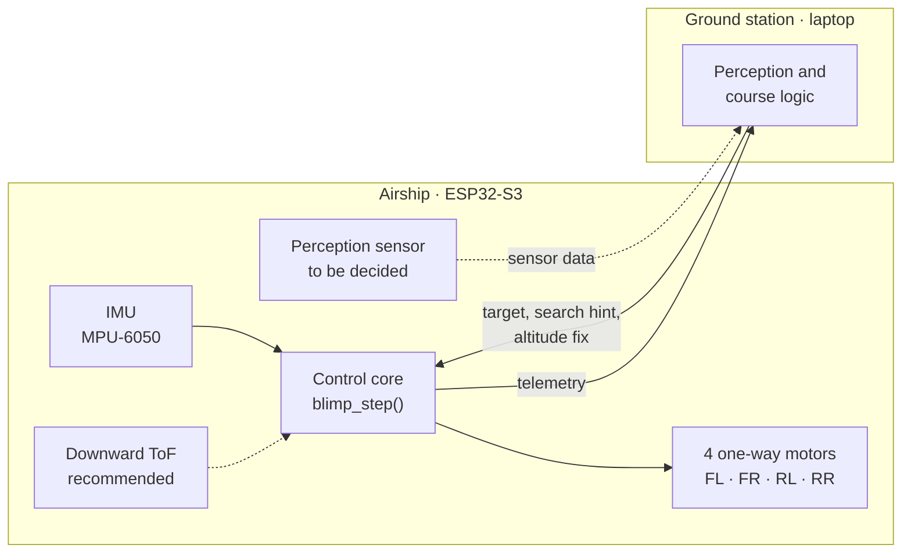
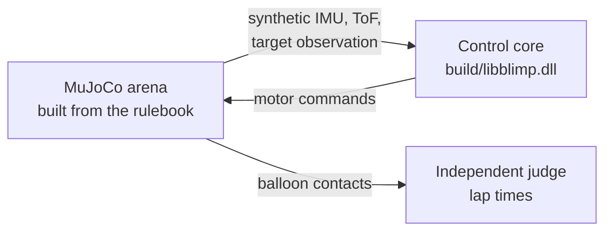

# DroneUN

**An autonomous blimp for IAR-LARC 2026**, a Universidad Nacional de Colombia team's entry in
*International Airship Racing at LARC*, held at Universidad Militar Nueva Granada in Bogotá.

A helium blimp has to fly itself around a course and physically touch four tethered red
balloons in a set order, on two different courses. The lowest combined time wins. The catch:
**all motors together may produce at most 100 grams-force of thrust.**

This repository holds the flight controller, the ESP32-S3 firmware, a MuJoCo simulation of both
race courses, and the analysis behind the design.

> **One controller, two hosts.** The whole flight controller is a single portable C function,
> `blimp_step()`. The firmware runs it on the airship; the simulation loads the same source
> compiled as a DLL. Whatever is tuned in simulation is exactly what flies.

---

## Status

| Part | State |
|---|---|
| **Control core** · `core/` | ✅ 11,276 unit checks pass, including a sweep of 114,244 actuator demands proving the 100 gf cap cannot be exceeded |
| **Simulation** · `sim/` | ✅ Completes both courses: every loop with a downward range sensor, about two in three without one |
| **Firmware** · `firmware/` | 🟡 Builds and links for the ESP32-S3 with the real pin map; not yet flashed |
| **Ground station** | ⬜ Not started: perception, search hint, altitude fix |
| **Hardware** | 🟡 Flight controller confirmed; motor thrust not yet measured; perception sensor and final electronics still being chosen |

### Simulated lap times

Five runs per cell (sensor-noise seeds 0–4), 0.78 m envelope, camera field of view 58 × 45°
(the measured OV2640 lens, see [docs/10](docs/10-known-issues.md)), up to 3 loops within 220 s
of simulated time per run:

| Course | Current board (no altitude sensor) | With a downward ToF sensor |
|---|---|---|
| 1 · rectangle | 6 of 15 loops completed · best laps 19.0–78.7 s | 15 of 15 loops completed · best laps 21.6–24.0 s |
| 2 · figure-eight | 8 of 15 loops completed · best laps 25.9–113.4 s | 15 of 15 loops completed · best laps 23.0–24.2 s |

Without an altitude reference the vehicle went into failsafe in all 10 runs; with the ToF sensor,
in none, and every loop finished. With the earlier, optimistic 90 × 70° camera the sensorless
board had completed 19 of 30 loops: the real lens loses the balloons more often, and every lost
sighting is a lost altitude reference, while the ToF rows did not move. That is why the top hardware recommendation is a **VL53L1X
time-of-flight sensor** (about 2 g) on the existing I²C bus, which the firmware and estimator
already support.
Every number here simulates a vehicle that has not been weighed or thrust-tested yet;
[docs/10](docs/10-known-issues.md) lists what that leaves out.

---

## The race

The rules that shape the design, from the official rulebook (see [reference/](reference/)):

| Rule | Constraint |
|---|---|
| 13 | Total thrust across all motors ≤ **100 gf** (servos excluded) |
| 11 | Neutrally buoyant to within **±10 gf** |
| 10 | Helium ≤ one 50-inch balloon's worth; any envelope shape is allowed |
| 14 | Fits in a **1 m × 1 m × 1.5 m** box |
| 1, 15 | Fully autonomous; all sensing onboard, but **computation may run offboard** |
| 2–4 | Touch the four balloons in the announced order; the clock starts at the first touch |
| 5–6 | Up to 3 loops per course; the best loop on each of the two courses, summed, is the score |
| 7 | A run is void if the airship leaves the competition area or needs human help |
| 18–22 | 10 m × 5 m arena; four 22-inch red mylar balloons at 2 m height on a 4 m × 2 m rectangle; course 1 goes round it, course 2 is a figure-eight |

Offboard computation is the most useful rule in the book: heavy processing can run on a laptop,
and the airship only has to carry sensors, the controller and a radio.

The rulebook also contradicts itself twice. Rule 12 says there are no size limits while Rule 14
sets a box, and Rule 10's "approximately 1 m³" would be a 1.27 m sphere that does not fit in
that box. We design to the stricter reading; the questions for the organizers are in
[docs/01](docs/01-competition-brief.md).

---

## Why small is fast

One piece of physics drives every design decision.

**Neutral buoyancy fixes the mass.** A neutrally buoyant body weighs exactly as much as the air it
displaces, so its mass is not a free choice; the envelope volume sets it:

```
m = ρ_air · V
```

**Added mass makes it heavier still.** An accelerating sphere also drags along air worth half its
displaced mass:

```
m_eff = m + ½ ρ_air V = 1.5 · ρ_air · V
```

**So acceleration falls as volume grows.** With thrust capped at F = 100 gf = 0.981 N:

```
a_max = F / (1.5 · ρ_air · V)
```

At Bogotá's air density (ρ ≈ 0.89 kg/m³):

| Envelope volume | Equivalent sphere | Vehicle mass (forced) | a_max | 4 m leg* |
|---:|---:|---:|---:|---:|
| 0.15 m³ | 0.66 m (26″) | 134 g | **4.9 m/s²** | ~1.9 s |
| 0.25 m³ | 0.78 m (31″) | 223 g | **2.9 m/s²** | ~2.4 s |
| 0.40 m³ | 0.91 m (36″) | 356 g | **1.8 m/s²** | ~3.0 s |
| 0.785 m³ | 1 × 1 × 1.5 m ellipsoid (box limit) | 699 g | **0.94 m/s²** | ~4.2 s |

<sub>\* Accelerate, then decelerate; drag neglected; indicative only.</sub>

> **The smallest envelope that can lift the electronics is the fastest vehicle.** Using the full
> volume allowance would make the airship roughly five times slower. Every gram saved on
> electronics lets the envelope shrink, and that compounds straight into lap time. Mass
> reduction *is* the race strategy.

A streamlined envelope is about 7 % faster, but at useful volumes it breaks the 1.5 m box and
handles badly in sideslip, so the envelope is a **sphere**. Target lap times and the full argument
are in [docs/05](docs/05-race-strategy.md).

### Altitude changes the size, not the speed

Bogotá sits at about 2,640 m, where air is roughly 73 % as dense as at sea level, so each litre of
helium lifts about 27 % less. That hurts if you buy an off-the-shelf balloon, because spec sheets,
build videos and papers almost always quote sea-level lift.

If you size your own envelope, the penalty cancels. Carrying the same 180 g of envelope and
electronics needs 38 % more volume (a 0.77 m sphere instead of 0.69 m), yet total mass, added
mass and maximum acceleration stay within 1 %, and top speed even improves by about 5 %. Neutral
buoyancy means mass *is* displaced-air mass either way. Altitude is a sizing and logistics problem
(fitting the box, helium per fill, handling a bigger balloon), not a performance one.

### What "50-inch balloon" really means

The rulebook equates a 50-inch balloon with "approximately 1 m³", while the baseline MochiSwarm
paper says its 50-inch foil balloon gives 120 g of net lift. Those two figures are about nine
times apart. The explanation is that "50-inch" is the foil balloon's flat, *uninflated* size.
Inflated, it is a lens of roughly **0.17 m³**, back-solved from the 120 g figure. So Rule 10 is far
looser than it reads, the Rule 14 box binds first, and we want to be smaller than either anyway.

The largest remaining unknown is the envelope film's weight per area (42 vs 85 g/m² across
sources), which swings usable payload at Bogotá between about 88 g and 200 g. One afternoon with
a balloon and a scale settles it; the procedure is in [docs/00 §C](docs/00-action-now.md).

---

## How it works

### The vehicle

The flight controller is the Seeed × Max Imagination **ESP-FLY** board: a XIAO ESP32-S3, an
MPU-6050 IMU and four MOSFET-driven brushed coreless motors. It has no magnetometer, barometer or
range sensor.

| Motors | Push | Provide |
|---|---|---|
| Front pair (FL, FR) | forward | surge, and yaw by running one faster than the other |
| Rear pair (RL, RR) | up | heave |

Every motor pushes one way only, and that shapes the whole controller:

- **No brakes.** Drag is the only thing that slows the airship, so arrival speed is decided on the
  way in.
- **No push-down.** The airship is trimmed a few grams heavy and the rear pair holds it up.
  Switching the motors off makes it sink gently to the floor, which doubles as the failsafe.
- **No turning on the spot.** Yaw needs one front motor faster than the other, so every turn costs
  some forward motion.
- **No sideways force.** Cross-track error is corrected by re-aiming.

### The software



- **Control core** (`core/`, C11): an estimator; a guidance state machine that, for each balloon,
  searches, aligns, approaches, touches, confirms the contact and coasts; PID loops for altitude,
  yaw and surge; and a mixer that enforces the thrust budget. It is freestanding, with no dynamic
  allocation, no global state and deterministic output, so flight logs can be replayed.
- **Firmware** (`firmware/`, ESP-IDF): sensor and motor drivers, the ESP-NOW radio link, and three
  FreeRTOS tasks that call `blimp_step()` at 200 Hz. No control logic lives here.
- **Ground station** (not written yet): each command packet carries the target balloon's bearing,
  elevation and range; a search-hint heading; and an altitude fix computed from any balloon in
  view, since they all hang at 2 m ([protocol.h](firmware/main/net/protocol.h),
  [docs/10 §4](docs/10-known-issues.md)). Which onboard sensor feeds it is still open; a 360°
  lidar is being evaluated.
- **Simulation** (`sim/`, MuJoCo): replaces everything around the core. It builds the arena from
  the rulebook, synthesises noisy IMU, ToF and target observations from ground truth, applies the
  core's motor commands, and runs its own judge that times laps from real balloon contacts.



---

## Repository layout

```
core/               Portable C11 flight controller and its host unit tests
  include/blimp/      Public headers; blimp.h is the single entry point
  src/                Estimator, guidance, PID, mixer, parameters, FFI shim
  tests/              One test program per module
firmware/           ESP-IDF project for the ESP32-S3
  main/               RTOS shell, board pin map, drivers, ESP-NOW link and protocol
sim/                Closed-loop MuJoCo simulation that drives the compiled core
  scene/              Course generator and physics checks, from the rulebook geometry
tools/              Build, verify and environment-setup scripts
  lens_test/          ESP32-CAM bench firmware + PC tool that measures camera modules (field of view, IR filter, ...)
docs/               Design, strategy, setup and status documents
research/           The research behind the docs, with sources and fact-checks
reference/          Where to download the rulebook and the baseline paper
```

---

## Getting started

Verified on Windows 11. You need:

- **Python 3.12** for the simulation
- **clang** (LLVM) on `PATH` for the core's unit tests and the simulation DLL
- **ESP-IDF v5.3**, only for the firmware; see [docs/08](docs/08-firmware-setup.md)

```powershell
python tools/setup_env.py        # once: creates .venv with the pinned MuJoCo build
python tools/verify.py           # builds and tests the core, smoke-tests the sim (~15 s)
python tools/verify.py --full    # adds both courses, with and without ToF (~1-2 min)
```

`verify.py` exits non-zero if any check fails, the Rule 13 thrust sweep included. Run the fast
suite often and the full one before any flight.

### Fly a course in simulation

```powershell
python tools/build.py dll                                       # after any change to core/
.venv\Scripts\python sim\run_course.py --course 1
.venv\Scripts\python sim\run_course.py --course 2 --altitude-source tof --seed 3
```

Each run prints one row per loop and the best time. The first 60 s of every run are the gyro-bias
convergence, so the default 150 s budget usually stops before the third loop; add
`--max-time 220` to reproduce the table above. `--help` lists every option, and
[docs/09](docs/09-simulation.md) explains the output.

To reproduce the whole table, or to judge whether a change helped, run the same matrix across
seeds:

```powershell
python tools/sim_sweep.py                                       # both courses, none + ToF, seeds 0-4
python tools/sim_sweep.py --courses 1 --altitude-sources tof --seeds 0-9 --markdown
```

### Test one core module

```powershell
python tools/build.py module mixer      # or: pid, params, estimator, guidance, blimp
```

### Build and flash the firmware

```powershell
tools\idf_build.bat                     # build, with the ESP-IDF PATH traps handled

. .\tools\idf_env.ps1                   # or enter the ESP-IDF environment in PowerShell
cd firmware
idf.py -p COM5 flash monitor
```

> [!WARNING]
> Before the first powered test, set `BLIMP_BOOT_MOTOR_ID_MODE` to `1` in
> [board_config.h](firmware/main/board_config.h), flash with **the props off**, and write down
> which motor actually spins for each position; then set it back to `0`. Measure real motor
> thrust on a thrust stand too: the controller still assumes a 35 gf-per-motor placeholder, and
> Rule 13 compliance depends on the real number.

### Working with coding agents

[AGENTS.md](AGENTS.md) holds the project's rules, commands and gotchas for any coding agent.
OpenAI Codex reads it directly, as do many other agents (see [agents.md](https://agents.md)), and
[CLAUDE.md](CLAUDE.md) imports it for Claude Code. Three workflows are packaged as skills:

| Skill | What it does |
|---|---|
| `core-change` | Checklist for changing the C flight controller safely; agents also apply it on their own when editing `core/` |
| `sim-sweep` | Runs the seed sweep, compares it with the recorded results and updates the tables |
| `flash-firmware` | Builds and flashes the ESP32-S3, including motor-identification mode; runs only when you ask for it |

In Claude Code, run a skill as `/sim-sweep`; in Codex, as `$sim-sweep` or from `/skills`. The
originals live in `.claude/skills/`. After editing one, run `python tools/sync_skills.py` to
regenerate the Codex copies in `.agents/skills/`; `tools/verify.py` fails until you do. Keep
personal Claude notes in `CLAUDE.local.md`, which is gitignored.

---

## Documentation

| Document | What's in it |
|---|---|
| **[docs/10 · Known issues](docs/10-known-issues.md)** | **Start here.** What is broken, unresolved or deferred, and why |
| [docs/07 · Control design](docs/07-control-design.md) | Plant model, mixer, loop gains, estimator, guidance, bring-up ladder, system identification |
| [docs/09 · Simulation](docs/09-simulation.md) | Running the simulation and reading its output |
| [docs/08 · Firmware setup](docs/08-firmware-setup.md) | ESP-IDF on Windows: install, the traps, build, flash, monitor |
| [docs/05 · Race strategy](docs/05-race-strategy.md) | Target lap times, envelope size and shape, rule exploits, touching without popping |
| [docs/01 · Competition brief](docs/01-competition-brief.md) | Rules, logistics, open questions for the organizers |
| [docs/02 · Hardware](docs/02-hardware.md) | Envelope sizing, weight budget, bill of materials |
| [docs/03 · Software architecture](docs/03-software-architecture.md) | The original architecture plan and the esp-drone verdict |
| [docs/04 · Risks and troubleshooting](docs/04-risk-and-troubleshooting.md) | Risk register, symptom → cause → fix tables, checklists, field kit |
| [docs/00 · Action list](docs/00-action-now.md) | Organizer emails, questions about the PCB, the balloon-lift experiment |
| [research/](research/) | The research digests behind all of the above, with sources and verdicts |

Several documents were written for the earlier tilting-bicopter design, or before the firmware
first built, and keep that history. For the current design, docs/07 and docs/10 take precedence.

---

## What's next

1. **Bench bring-up**: flash the board, run motor-ID mode, check the IMU axes and the battery
   divider ([docs/10 §6](docs/10-known-issues.md)).
2. **Thrust stand**: measure per-motor thrust and the duty-to-thrust curve to replace the
   placeholder.
3. **Sensors**: fit the downward ToF; settle the perception sensor and the electronics stack.
4. **Ground station**: target observation, search hint and altitude fix.
5. **Envelope and gondola**: measure a real balloon's lift, weigh the gondola, and re-run the
   simulation with measured numbers.
6. **Arena boundary**: teach the simulation's judge Rule 7's boundary, then keep the vehicle
   inside it.
7. **Flight**: tethered, then free; tune the loops; timed autonomous laps.
8. **Team Description Paper**, spares and field kit.

## Biggest risks

- **Unmeasured thrust.** Gains, lap times and Rule 13 compliance all rest on a placeholder.
- **Envelope lift.** If the film is at the heavy end, the electronics may need an envelope too
  large to be competitive.
- **Leaving the arena.** With no brakes it is easy to overshoot a balloon, and Rule 7 voids the
  run. The simulation does not check this yet.
- **Air currents.** Drafts from ventilation can exceed what 100 gf can fight; test in a large hall
  early.
- **Perception.** Nothing exists yet between the sensor and the controller.

The full register is in [docs/04](docs/04-risk-and-troubleshooting.md).

---

## Prior work

- **[MochiSwarm / BlimpSwarm](https://github.com/LehighBlimpGroup/BlimpSwarm)** (Lehigh
  University): the baseline design the rulebook names. Paper:
  [arXiv:2503.03077](https://arxiv.org/abs/2503.03077).
- **[mochi-swarm-sim](https://github.com/TongshuWu1/mochi-swarm-sim)**: the MuJoCo blimp model we
  used as a reference. Its race scenes are not the IAR course, so ours is generated from the
  rulebook.
- **[esp-drone](https://github.com/espressif/esp-drone)** (Espressif): firmware infrastructure
  patterns.
- **[ESP-FLY](https://github.com/Seeed-Projects/Co-Create_ESP-FLY)** (Seeed × Max Imagination): the
  flight-controller board and its pin map.

No third-party code is copied into this repository.

## License

No license has been chosen yet, so all rights are reserved. Please ask the team before reusing
anything here.
