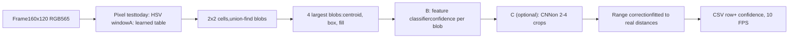

target_cam · feasibility analysis · 2026-10-14 · no code changed

# A small neural network on the *ESP32-CAM*?

Can a learned model, running inside the AI-Thinker ESP32-CAM, recognise the red mylar waypoint balloons better and estimate their distance better than the current colour-blob detector, while the camera keeps sending its CSV row 10 times a second? Yes, in a narrow form: a small model that works only on what the colour detector already found, or a learned colour table. A network that scans the whole frame does not fit.

learned colour table: fits, \~0 ms blob-feature classifier: fits, µs crop CNN: fits for 2–4 crops, measure heat full-frame CNN: does not fit at 10 FPS

Contents

1. [01Short answer](#answer)
2. [02What the chip can spend](#chip)
3. [03Four options, cheapest first](#options)
4. [04Frame budget calculator](#budget)
5. [05A · Learned colour table](#lut)
6. [06B and C · Checking each blob](#verify)
7. [07Distance](#distance)
8. [08Training data and the venue](#data)
9. [09Fitting it into the project](#integration)
10. [10Recommended order](#plan)
11. [11Measured, estimated, unverified](#evidence)

01 · Verdict

## Short answer

Recognition

Feasible

A learned colour table and a small per-blob classifier both fit inside the current 100 ms frame, with most of the frame still idle. They attack the two real failure modes: the mylar's odd colour and colour-matching clutter.

Distance

Little to gain

Range is limited by how many pixels the balloon covers. A network cannot recover detail that 160×120 does not contain. A correction fitted to measured distances gets most of what is available, without a network.

Output rate

Unchanged

10 FPS and 115200 baud stay. A confidence column adds a few bytes per row: about 13 % of the link today, a few percent more after.

Before any of this

Finish the hand calibration with tcview first. It shows which failure is real (colour, clutter or range), and the frames saved during it are the training data that every option below needs.

02 · Constraints

## What the chip can spend

| Resource | Value | Status | What it means for a model |
| --- | --- | --- | --- |
| CPU | ESP32 (LX6), 2 cores, 240 MHz | known | No vector (SIMD) instructions, unlike the ESP32-S3. Neural-network layers run as plain C multiply-adds. |
| Frame period | 100 ms at 10 FPS | measured | The hard real-time budget per frame. |
| Current detection | ≈ 8.2 ms per frame | measured | About 90 ms is idle today. |
| Idle time | ≈ 92 % of each frame | thermal budget | The firmware paces itself so the board stays cool. Every 10 ms added per frame is +10 % CPU duty. Measure the temperature, not just the time. |
| Internal RAM | ≈ 520 KB total | known | Already holds 2 × 38.4 KB frame buffers and the 28 KB detector workspace. A small model needs well under 10 KB of activations. |
| PSRAM | 4 MB, enabled | configured | Room for larger tables, but slower than internal RAM for per-pixel lookups. |
| Flash, app | ≈ 64 % of the 1 MB app partition free | measured | Model weights of a few KB are trivial. Even a TensorFlow Lite Micro runtime would fit. |
| Flash, settings (NVS) | Default 24 KB partition | reasoned | An 8 KB colour table fits but makes NVS tight. A small dedicated data partition is cleaner. |
| Serial link | 115200 baud, ≈ 150 B per row | measured | ≈ 13 % used at 10 FPS. Faster baud rates failed on the ESP32-CAM-MB bridge. |

Espressif's optimised NN kernels (ESP-NN) and its ESP-DL library mainly target the ESP32-S3 and ESP32-P4. On the original ESP32 most layers fall back to generic C, so this analysis assumes plain-C speed.

03 · Options

## Four options, cheapest first

|  | Option | Fixes | Cost per frame (estimated) | At 10 FPS |
| --- | --- | --- | --- | --- |
| A | **Learned colour table** 65,536 yes/no bits, one per RGB565 value | The colour test itself: mylar reads pink-magenta with a wide hue spread | ≈ 0 ms, likely faster than the HSV maths it replaces | fits |
| B | **Classifier on blob features** logistic regression or 2-layer MLP, \~10 inputs | Clutter that passes colour: wood, skin, pink walls, red objects | a few hundred multiply-adds per blob: microseconds | fits |
| C | **Small CNN on candidate crops** 3 int8 conv layers on 16×16 or 24×24 | Clutter whose shape fools B | ≈ 3–15 ms per crop | fits for top 2–4 blobs |
| D | **Full-frame CNN detector** MobileNet-SSD, YOLO-tiny, FOMO | Everything, in principle | ≈ 7.5 M multiply-adds even for a 96×96 MobileNet v1 0.25: 125–300+ ms | does not fit |

Where each option would sit in the existing pipeline. A replaces a step; B, C and the range correction add steps after it. The colour detector stays as the cheap proposal stage in every case.

04 · Interactive

## Frame budget calculator

Switch the options on and set the speed you expect from the ESP32's plain-C multiply-adds. The bar is one 100 ms frame at 10 FPS. Cycles per multiply-add is the main unknown: the 4–10 range is an estimate for hand-written int8 C on this core and has to be measured.

[x] **A · Learned colour table**Replaces the HSV test. Assumed to cost the same as today. [x] **B · Feature classifier**≈ 0.05 ms for 4 blobs, including extra features. [x] **C · Crop CNN**Layers 3→8→16→16, pooling between, ≈ 648·N² multiply-adds. [ ] **D · Full-frame CNN**96×96 MobileNet v1 0.25, ≈ 7.5 M multiply-adds.

Crop size N×N16

Crops per frame2

Cycles / mult-add6

Frame rate10 FPS

050 ms100 ms

detector today (8.2 ms, measured) B C D

CNN per crop

work per frame

CPU duty

CNN weights

05 · Option A

## Learned colour table

The camera delivers RGB565, so every pixel is one of exactly 65,536 values. Any decision about a single pixel, however it was learned, can be stored as a table of 65,536 yes/no bits: 8 KB. That makes even a large model free at run time, because the model runs once on the PC and the camera only looks up the answer.

1. **Label.** In frames saved with tcview's *Save frame…*, mark balloon pixels and background pixels (a region tool in the viewer would do it).
2. **Train on the PC.** Anything works: colour histograms (balloon count ÷ background count per colour), a Gaussian mixture, or a small MLP on R, G, B.
3. **Bake.** Evaluate the model once for all 65,536 colours and pack the answers into 8 KB.
4. **Run.** On the camera one lookup replaces the HSV test. Pooling, blobs, centroid and range stay exactly as they are.

Why it suits mylar

On 2026-10-13 the balloon's centre read H304 ± 109°, S78, V188. A single hue window cannot describe that. A table can follow any shape in colour space, for example keeping magenta-tinted reflections while rejecting wood.

What it costs

You lose sliders you can read and retune at the venue in minutes. Keep the HSV test as a fallback mode, selectable by command, so a bad table can never strand the camera.

tcview could load the same table and show its mask, so the rule "the overlay is the camera's own code" still holds.

06 · Options B and C

## Checking each blob

### B · Classifier on blob features

A balloon has a shape signature that wood and walls lack. Most of these numbers are already computed, and the rest are cheap to add during the existing pixel pass:

fill

area ÷ box. A disc is about 0.79; mylar reads lower because of its highlight hole.

aspect

w ÷ h, close to 1 for a balloon.

hue / sat spread

Inside the blob. Mylar reflections spread more than painted wood.

highlight

Is there a bright, low-saturation spot inside the box?

edge sharpness

A balloon has a crisp outline against the room.

position

The balloons hang 2 m above the floor; with attitude, elevation is informative.

Logistic regression or a 2-layer MLP on about 10 features is a few hundred multiply-adds per blob. It outputs a confidence, which fits the firmware's rule of failing honestly: below a threshold, the blob is not reported and `ok=0` still means "no measurement".

### C · Small CNN on the candidate crops

Cut out the box of each of the top 2–4 blobs, with a margin, resize it to N×N, and run a tiny integer network: balloon or not. It learns roundness, the highlight and the shading gradient directly from pixels.

| Layer | Output (N = 24) | Multiply-adds | Weights |
| --- | --- | --- | --- |
| Input crop, RGB | 24×24×3 | – | – |
| Conv 3×3, 3→8, ReLU | 24×24×8 | 124,416 | 216 |
| Max-pool 2×2 | 12×12×8 | – | – |
| Conv 3×3, 8→16, ReLU | 12×12×16 | 165,888 | 1,152 |
| Max-pool 2×2 | 6×6×16 | – | – |
| Conv 3×3, 16→16, ReLU | 6×6×16 | 82,944 | 2,304 |
| Global average, dense → 1 | confidence | 16 | 17 |
| **Total** |  | **≈ 373 k** | **≈ 3.7 k (int8)** |

At N = 16 the total drops to about 166 k. Activations peak at 4.6 KB. Written in plain portable C next to `blob_detect.c`, it needs no TensorFlow Lite Micro, stays testable in the host suite, and tcview can call it through the same ctypes path to show the network's verdict on each box.

Why not a full-frame network

Even TensorFlow's tiny person-detection model (96×96 greyscale MobileNet v1 0.25) is about 7.5 M multiply-adds. On this chip that is roughly 125–300+ ms per frame before anything else runs, and the board would run hot. On an ESP32-S3 camera board, with vector instructions, the same model is roughly an order of magnitude faster; that is a hardware change, outside this question.

07 · Range

## Distance

Range is computed as `diameter_mm × f ÷ apparent size in px`. Its error has two parts, and a network helps with neither as much as simpler tools do.

Bias (simulated, not measured)

### ≈ 5–11 % long

The highlight and the dark side drop out of the mask, so the box is a little small. A correction fitted to 3–4 measured distances removes most of it.

Quantisation (geometry)

### 1 px = 2 % at 2 m, 7 % at 6 m

The balloon is ≈ 44 px wide at 2 m and ≈ 14 px at 6 m. No model can recover detail the image does not contain.

| Approach | Gain | Cost |
| --- | --- | --- |
| Fitted correction (linear in 1/size, or a small table) | Removes the systematic bias | A tape measure and 3–4 readings. No run-time cost. |
| Sub-pixel circle fit on the blob's edge | Better than 1 px size resolution at range | Classical maths on the edge pixels, ≈ 1 ms |
| Hole filling before measuring | Less undercount from the highlight | Cheap; changes the area, not the box |
| NN regression head on the crop | Could learn the same correction | Needs many images at measured distances; unlikely to beat the calibrated formula by much |
| Higher resolution (QVGA 320×240) | Halves quantisation error | 4× pixels, 4× detection time, frame buffers move to PSRAM |

08 · Risks

## Training data and the venue

- **Collection speed.** At the only working baud rate (115200), a full frame takes 3.4 s, so 1,000 frames take about an hour. Sending only the 24×24 crops (≈ 1 kB each, ≈ 0.1 s) would make collection about 30× faster and is enough for options B and C.
- **The venue is not the lab.** A model trained on this room's clutter may not reject the clutter at the competition. Sliders retune in minutes on site; a model needs new data and retraining. The collection and training workflow has to be quick enough to run at the venue, or the HSV fallback has to stay usable.
- **Overfitting with few balloons.** With only a handful of physical balloons, vary distance, angle, lighting and background deliberately, and keep a held-out set recorded on a different day.
- **Heat.** More CPU duty on a board known to run warm. Measure the temperature during a long run with the model on.

09 · Integration

## Fitting it into the project

| Project rule | What it requires of a model |
| --- | --- |
| Detector is portable C, tested on the host | Write inference in plain C next to `blob_detect.c`; add host tests with recorded frames. |
| Fail honestly: `ok=0` means no measurement | Low confidence means no blob reported, never a guessed position. |
| tcview overlay is the camera's own code | Expose table lookup and classifier through the shared library, so the viewer shows the camera's verdict. |
| 25-column CSV read by tcview and, later, the S3 | A confidence column changes the format. Version it, and update both readers together. |
| Settings in versioned NVS records | Store the model or table with a version and checksum; reject a mismatch and fall back to HSV, as settings already do. |
| Flash writes need whole words (`!save`) | Uploading a model needs its own guarded command and a CRC, like the frame link. |

10 · Plan

## Recommended order

1. **Finish the hand calibration** and save frames of every failure: missed balloon, clutter detected, wrong range. This decides which of the next steps is needed at all.
2. **Fit the range correction** with the balloon at 3–4 measured distances. Cheap, and needed whatever else you do.
3. **If colour is the problem** (the 2026-10-13 result suggests it is): build the learned colour table, A, with HSV kept as fallback.
4. **If clutter still passes:** add the feature classifier, B, with a confidence column.
5. **Only if B is not enough:** the crop CNN, C, on the top 2 blobs at 16×16. Measure time and temperature on the board before keeping it.

11 · Evidence

## Measured, estimated, unverified

| Claim | Kind |
| --- | --- |
| 10.0 FPS, detection ≈ 8.2 ms, RGB565 big-endian | measured 2026-10-13 |
| Balloon centre H304 ± 109, S78, V188; red preset missed it at 1.5 m | measured 2026-10-13 |
| Only 115200 baud works on the ESP32-CAM-MB | measured 2026-10-14 |
| CNN multiply-add counts and weight sizes | calculated |
| 4–10 cycles per int8 multiply-add on the ESP32 in plain C | estimate, to measure |
| ESP-NN / ESP-DL acceleration mainly on S3 and P4, generic C on the ESP32 | from memory of Espressif docs, to check |
| Range bias 5–11 % long | host simulation only |
| Heat impact of extra CPU duty | unmeasured |
| A learned table or classifier generalising to the competition venue | unknown |

Companion to the target_cam & tcview guide · branch target-cam-balloon-detector · analysis only, no firmware changed · 2026-10-14.