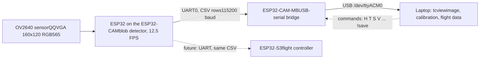
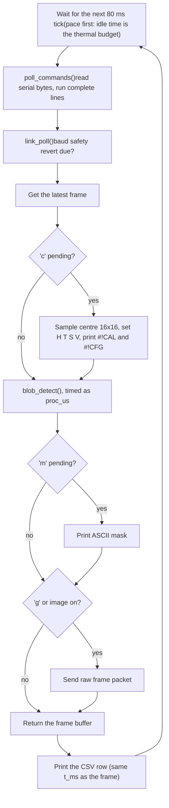
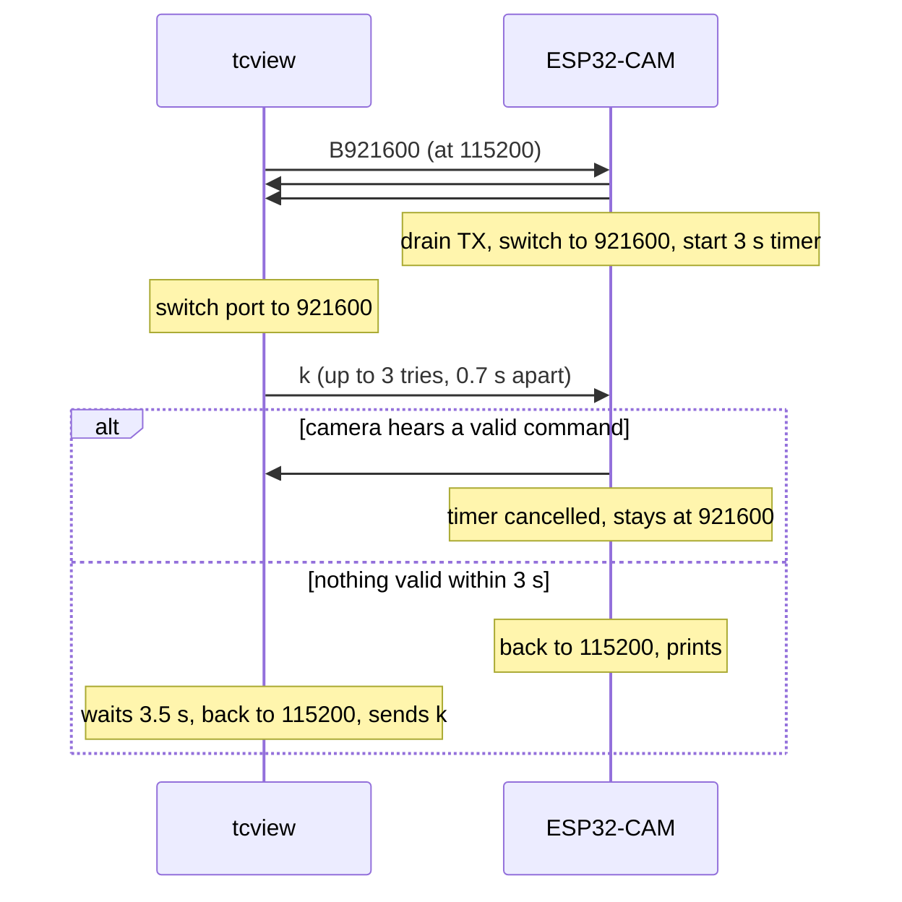
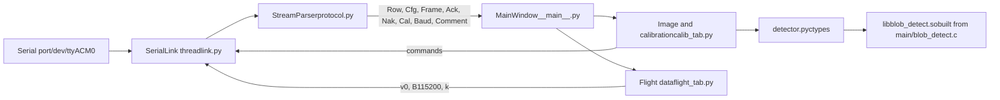

IAR-LARC 2026 blimp · forward camera · report dated 2026-10-14

# target_cam & tcview

The ESP32-CAM firmware that finds the red waypoint balloons, and the PC program used to see the camera's real image and calibrate its colour test by hand. This page explains how both work, how they talk to each other, and how to run a calibration.

firmware flashed & running flight-data screen verified frames received at 115200 calibration on the real balloon in progress !save on hardware not yet tested faster baud rates fail on this programmer

Contents

1. [01The system in one picture](#overview)
2. [02How the colour detector works](#detector)
3. [03Try the pixel test](#bench)
4. [04From pixels to bearing and range](#geometry)
5. [05Firmware: boot and main loop](#firmware)
6. [06The CSV stream (flight output)](#output)
7. [07Commands and replies](#commands)
8. [08Sending raw frames](#frames)
9. [09Baud changes and the safety revert](#baud)
10. [10Settings in flash](#flash)
11. [11tcview: how the PC side is built](#viewer)
12. [12Image & calibration screen](#calib-screen)
13. [13Flight data screen](#flight-screen)
14. [14Calibration procedure](#procedure)
15. [15Tuning by symptom](#tuning)
16. [16Tests and bench record](#verification)
17. [17Known limits and open questions](#limits)
18. [18Files and how to run](#files)

01 · Overview

## The system in one picture

The blimp must fly between four red mylar balloons (22 inch, 50–60 cm across, centres 2 m above the floor, on a 4 m × 2 m rectangle). A forward-looking AI-Thinker ESP32-CAM finds them. It reads 160×120 colour frames from its OV2640 sensor at 12.5 FPS, runs a colour-blob detector on every frame, and prints one CSV line per frame on its serial port: where the largest red blob is (bearing left/right and up/down), how big it is, an estimated range, and the bearings of up to three more blobs.

In flight that CSV line goes to the ESP32-S3 flight controller. On the bench it goes through the ESP32-CAM-MB programmer board and its USB bridge to a laptop, where **tcview** runs. tcview can also ask the camera for its raw pixels, so you can see exactly what the detector sees and tune it by hand.



Bench and flight paths. The camera's flight output is the CSV stream; images, baud changes and the `#!` protocol lines exist for the bench only.

On the camera

### target_cam firmware

ESP-IDF v5.5.5 + esp32-camera 2.1.8, original ESP32. No WiFi, no Bluetooth (both radios are absent from the binary). Detector in portable C, so the same file is also compiled and tested on the PC. Settings are kept in flash.

On the laptop

### tcview viewer

Python 3.10, PyQt6, pyqtgraph, numpy, pyserial, in its own conda env `targetcam`. Two screens: *Image & calibration* and *Flight data*. It loads the camera's own detector C code through ctypes, so its overlay is the camera's rule.

Why a viewer at all

On 2026-10-13 the red preset did not detect the real balloon at 1.5 m. The centre of the balloon read hue 304° ± 109°, saturation 78, value 188: a pink-magenta average with a huge spread, likely because mylar mirrors the room. The only tools then were CSV numbers and an ASCII mask relayed through a chat. Calibrating colour honestly needs the real pixels, so the firmware gained a raw frame link and the PC gained a viewer.

02 · Detector

## How the colour detector works

The detector lives in `main/blob_detect.c`. It has no ESP-IDF, no RTOS and no heap use: the caller hands it a 28 kB workspace once. That is what lets the identical file run on the camera, in the host test suite, and inside tcview.

### Step 1 · Every pixel: hue, saturation, value

The sensor delivers RGB565: 16 bits per pixel, 5 bits red, 6 green, 5 blue. The camera sends the high byte first (big-endian). This was read from the driver source and confirmed on the bench on 2026-10-13.

15

14

13

12

11

10

9

8

7

6

5

4

3

2

1

0

R4

R3

R2

R1

R0

G5

G4

G3

G2

G1

G0

B4

B3

B2

B1

B0

byte 0 on the wire (big-endian): R4..R0 G5..G3

byte 1: G2..G0 B4..B0

A wrong byte order scrambles every colour. The `o` command and the viewer's byte-order button flip it.

Each channel is expanded to 8 bits by bit replication (`r = r5<<3 | r5>>2`), so full scale is 255, not 248, and grey stays grey. Then:

value V

the largest channel, 0–255. Dark pixels have low V.

saturation S

`(max − min) · 255 / max`, 0–255. Greys, whites and walls have low S.

hue H

0–359°, the standard hexcone formula: 0 red, 30 orange, 60 yellow, 120 green, 210 blue, 300 magenta. Meaningless when S is near zero.

A pixel **matches** when all three tests pass. They run cheapest first, and the saturation test is done as `(max−min)·255 ≥ S_min·max` so most pixels are rejected without a single division:

1. **Bright enough:** `max ≥ val_min`, and the pixel is not a pure grey (`max − min > 0`).
2. **Colourful enough:** saturation ≥ `sat_min`. This is the main defence against skin, wood and walls.
3. **Right hue:** the circular distance between the pixel's hue and the target hue is ≤ `hue_tol`. Red wraps through 0, so hue 350 and hue 10 are both 10° from a 0° target.

Hue is the reason the test survives lighting changes: a red balloon in shadow becomes darker (V drops), not less red (H stays). The floors on S and V remove the greys and near-blacks whose hue is just noise.

### Step 2 · Pool into 2×2 cells

The 160×120 match map is pooled into 80×60 cells. A cell is set when at least half of its 4 pixels match. Single-pixel speckle disappears, and labelling cost and memory drop by four.

### Step 3 · Connect cells into blobs

Set cells that touch on a side (4-connectivity) are joined with union-find. The label arrays are sized for the worst possible input, a full-frame checkerboard, so no image can overrun them; the host suite checks this under AddressSanitizer.

### Step 4 · Measure the four largest blobs

Blobs smaller than `min_area` (default 25 pixels) are ignored. The four largest are reported, largest first. Their centroid and bounding box are computed from the actual matching *pixels*, not cells: the blob's own cells plus matching pixels in below-threshold cells that touch it. Without that edge pass, curved edges lost about 3 % of the area and biased sub-pixel centroids by up to 0.07 px; with it, the host suite measures 0.000 px centroid error and exact area.

Four blobs, not one, because the course has four identical red balloons. The largest is usually the nearest, which is not always the next waypoint. Choosing among them is the flight controller's job.

It fails honestly

If no blob reaches `min_area`, the result is `found = 0` and the CSV prints `ok = 0` with zeros. That means *no measurement*, not "target dead ahead". A blob that touches the frame edge is marked `clipped` and gets no range, because a cut-off target looks smaller and would read too far away.

### Colour presets

| Preset | Hue | ± tol | Window | Sat ≥ | Val ≥ | Notes |
| --- | --- | --- | --- | --- | --- | --- |
| **red** (default) | 0 | 12 | 348°–12° | 110 | 50 | Competition colour. Missed the real balloon at 1.5 m on 2026-10-13. |
| blue | 220 | 30 | 190°–250° | 90 | 40 |  |
| green | 125 | 35 | 90°–160° | 80 | 40 |  |
| orange | 25 | 10 | 15°–35° | 120 | 60 | Wood and brown furniture also pass. Use a plain background. |

Red and orange are only 25° apart, so their windows are narrow with a gap between them: a red balloon's lit side drifts toward orange, and an orange one's shadow toward red. Host test 14 checks that each preset finds only its own balloon.

03 · Interactive

## Try the pixel test

This is a JavaScript copy of the firmware's `blob_pixel_matches()`, with the same integer arithmetic. Pick a colour, move the thresholds, and watch which test rejects it. The colour is first quantised to RGB565, exactly as the sensor would deliver it.

Pixel colour

#dc141e

Thresholds

Hue0°

Tolerance ±12°

Min sat110

Min value50

060120180240300359

RGB565

on the wire

unpacked

H / S / V

The "balloon mean" swatch is the average colour the camera measured at the centre of the real balloon (H304, S78, V188). With the red preset it fails on hue and on saturation, which is why the balloon was missed. An average with ±109° spread is not one colour, so do not calibrate from it: look at the real image and pick the area that is actually red.

04 · Geometry

## From pixels to bearing and range

A pinhole model turns the centroid into angles. The horizontal field of view (h-FOV) sets the focal length in pixels. The stock 65° diagonal lens gives about 54° horizontally; this is an *assumed* value until it is measured, and it scales every angle and every range.

```
f        = 80 / tan(h-FOV / 2)            = 157 px at 54°   (0.365° per pixel at the centre)
az_deg   = atan((cx − 80) / f)            + is right of the nose
el_deg   = atan((60 − cy) / f)            + is above the nose
range_mm = target_mm · f / max(w_px, h_px)    −1 if clipped or target_mm = 0
```

Pixel *i* spans \[*i*, *i*+1), so the exact centre of the frame is (80, 60). Range comes from the larger side of the bounding box, not from the area: on mylar the white highlight and the dark far side both fail the colour test, so the area undercounts the balloon (range read 10–13 % long in the model) while the box spans the hole (5–11 % long). The remaining bias is systematic and is meant to be calibrated against a real balloon at a measured distance.

| Range | Radius on image | Detected (host model) | Bearing bias toward lit side | Box range reads |
| --- | --- | --- | --- | --- |
| 1 m | 43 px | yes | 5.3 px (1.9°) | 1.08 m |
| 2 m | 22 px | yes | 2.7 px (1.0°) | 2.11 m |
| 4 m | 11 px | yes | 1.4 px (0.5°) | 4.32 m |
| 6 m | 7 px | yes | 0.9 px | 6.64 m |
| 10 m | 4 px | yes | 0.5 px | 10.79 m |
| 12 m | 4 px | yes, 36 px area | 0.5 px | 12.34 m |

From the host suite's shaded mylar model (550 mm balloon, lit from the upper left, white highlight). These are simulation figures, not bench measurements. The arena is 10 m × 5 m, so every balloon in it is within this range.

Body frame only

The camera has no IMU, so az and el are relative to the camera. When the blimp rolls or pitches, the bearings tilt with it. The board that owns the IMU must rotate them into world bearings.

05 · Firmware

## Firmware: boot and main loop

### Boot sequence

1. **Boot report.** Reset reason and chip info, printed before anything risky, so a brownout loop is visible.
2. **Quiet the heat sources.** The flash LED (GPIO4) is driven low. Nothing in this firmware starts WiFi or Bluetooth.
3. **Settings.** Load the Kconfig defaults, then any settings saved in flash (NVS) replace them. The console says which: `loaded from flash`, `nothing saved`, or `saved record out of range, IGNORED`.
4. **Workspace.** Allocate the detector's 28 kB scratch memory once, in internal RAM.
5. **Serial link.** Install the UART0 driver (so commands can be read without blocking) and print the CRC-32 self-test line: `# link crc32 self-test cbf43926 (ok)`.
6. **5-second reflash window.** GPIO0 is the camera clock (XCLK) on this board, so once the camera starts esptool can no longer force download mode. The countdown is the window to reflash without the BOOT button.
7. **Camera power-up.** The largest current step the firmware takes. Two 38,400-byte frame buffers in internal DRAM (PSRAM only as a fallback), "grab latest" mode, AWB and gains on, lens correction on, gain capped at 4× to limit chroma noise.
8. **Settle.** 20 frames are thrown away (about 1 s) while exposure and white balance settle. Then a saved "AWB frozen" setting is applied, at the gains just found.
9. **Banner and `#!CFG`.** Human-readable settings, a `# settings saved|defaults` line, the command list, then the machine-readable config line for the viewer.

### Main loop (every 80 ms at 12.5 FPS)

80 ms is not an arbitrary choice. At XCLK 20 MHz the OV2640 spends a fixed 1.599 M clock cycles per QQVGA frame, so it delivers one every 80.00 ms (measured on optflow_cam). Pacing at the same period uses every frame the sensor makes, always at the same latency. The old 100 ms pace skipped one frame in five, and the age of the frame it processed wandered between 0 and 60 ms. XCLK and the FreeRTOS tick come from the same crystal, so the two stay locked. The pace is stored as a period in milliseconds, because 12.5 is not an integer.



Measured on the bench with the old 10 FPS default: a steady 10.0 FPS (`dt_ms` ≈ 100), with detection costing about 8.2 ms per frame. At 12.5 FPS (measured 2026-10-14: 12.505 rows/s, `dt_ms` 80.0, detection 7.3–8.2 ms) detection plus the blocking CSV print take about 21 ms of each 80 ms period, and the rest is idle, which keeps the board cool. CPU duty rises from about 21 % to about 27 %. While a raw frame is being sent the loop is blocked for the whole transfer (3.3 s at 115200), so timing on the calibration screen is not flight timing.

06 · Flight output

## The CSV stream

One line per frame, 25 comma-separated fields, at 115200 baud, 12.5 rows per second. This is the only thing the flight controller needs. A row is about 110–150 bytes, so at 12.5 FPS it uses roughly 16 % of a 115200 link.

```
t_ms,ok,cx_px,cy_px,az_deg,el_deg,area_px,w_px,h_px,fill,range_mm,clipped,blobs,matched_px,b2_az,b2_el,b2_range_mm,b3_az,b3_el,b3_range_mm,b4_az,b4_el,b4_range_mm,dt_ms,proc_us
12345,1,80.50,60.25,0.17,-0.08,123,14,13,0.68,1520,0,1,140,0.00,0.00,-1,0.00,0.00,-1,0.00,0.00,-1,100.0,8200
```

| Field | Meaning |
| --- | --- |
| `t_ms` | Capture time since boot. A frame and its row share this value. |
| `ok` | 1 = a blob was found. **0 means no target, not a target dead ahead**; every position field is 0 and must be ignored. |
| `cx_px`, `cy_px` | Centroid of the largest blob, sub-pixel. Frame centre is (80, 60). |
| `az_deg`, `el_deg` | Bearing of the largest blob. +az right, +el up, in the camera's frame. |
| `area_px` | Matching pixels in the largest blob. |
| `w_px`, `h_px`, `fill` | Bounding box and area ÷ box. A full disc gives about 0.79; mylar reads lower because of the highlight hole. |
| `range_mm` | `target_mm · f / max(w, h)`. −1 when range is off or the blob is clipped. |
| `clipped` | 1 if the box touches the frame edge. |
| `blobs` | Blobs at or above `min_area` in the frame. Can be more than 4. |
| `matched_px` | Matching pixels in the whole frame. Rising with no blob means scattered colour clutter: tighten S or T. |
| `bN_az`, `bN_el`, `bN_range_mm` | Blobs 2–4, in decreasing size. Absent ones print `0,0,-1`. |
| `dt_ms` | Measured time since the previous capture. About 80 at 12.5 FPS. |
| `proc_us` | Time spent in the detector for this frame. About 8200 on the bench. |

07 · Protocol

## Commands and replies

Commands are short text lines, case-sensitive (`S` is saturation, `s` toggles the stream). The camera reads them once per loop without blocking. Every line gets a machine-readable answer, and every accepted change is followed by the full configuration, so the PC never has to assume a command arrived.

| Command | Effect | Range / notes |
| --- | --- | --- |
| `p red` | Colour preset | `red blue green orange`, `p0`–`p3` or the first letter |
| `c` | Calibrate on the centre 16×16 patch | Refuses if saturation \< 70; warns if hue spread > 20° |
| `H<deg>` | Target hue | 0–359 |
| `T<deg>` | Hue tolerance ± | 1–90 |
| `S<n>` | Minimum saturation | 0–255 |
| `V<n>` | Minimum value (brightness) | 0–255 |
| `a<px>` | Smallest blob reported | pixels |
| `d<mm>` | Real target diameter for range | default 550; `d0` turns range off |
| `F<deg>` | Horizontal FOV | 10–150, decimals allowed |
| `f<fps>` | Frame rate | 1–30, decimals allowed (`f12.5`); rounded to a whole-ms period, e.g. `f15` → 67 ms |
| `w0` / `w1` | AWB frozen at current gains / auto |  |
| `o` | Flip RGB565 byte order | big-endian is correct for this board |
| `m` | Print the mask once as ASCII (4×4 px per character) | text fallback when the viewer is not at hand |
| `s` | Toggle the CSV stream |  |
| `?` | Banner and current settings |  |
| `k` | Print `#!CFG` | the viewer sends this on connect |
| `g` | Send one raw frame | see section 08 |
| `v1` / `v0` | Send a frame every loop / stop | timing not flight-representative while on |
| `B<baud>` | Change serial speed | 115200, 230400, 460800, 921600, 1500000, 2000000 |
| `!save` | Write the live settings to flash | whole word required |
| `!load` | Reload the saved settings |  |
| `!reset` | Erase saved settings, go back to defaults |  |

### Machine lines (all start with `#!`)

| Line | When |
| --- | --- |
| `#!ACK <cmd>` | The command line arrived and was accepted. |
| `#!NAK <cmd> -- <reason>` | Unknown command, out of range, trailing junk, or flash error. Example: `#!NAK H999 -- out of range (0..359)`. |
| `#!CFG w= h= cell= hue= tol= sat= val= area= mm= fov= fps= period_ms= awb= be= preset= baud= image= stream= settings=` | After every accepted command, on `k`, and at boot. `settings` is `saved`, `defaults` or `modified`. |
| `#!CAL ok\|refused hue= spread= sat= val=` | Result of `c`. |
| `#!BAUD <n>` | Just before a speed change, and on the safety revert. |
| `#!FRAME …` / `#!END seq=` | Around a raw frame (section 08). |

Human lines starting with `# ` are unchanged, so a plain serial terminal and the older `host/target_monitor.py` still work. Arguments are parsed strictly: `H35x` is refused instead of read as 35.

Why the flash commands are whole words

On 2026-10-13 a quick burst of commands arrived corrupted: `m` came through as `W`, and `H330` as hue 3. A single damaged byte must never be able to write to flash, so the three flash commands need the `!` prefix and the full word. The viewer also sends commands one at a time and waits for the ACK.

08 · Image link

## Sending raw frames

The viewer needs the exact pixels the detector saw, so frames go out uncompressed: 160 × 120 × 2 = 38,400 bytes of RGB565, framed by text lines on the same serial port as everything else.

**#!FRAME seq=7 t_ms=12345 w=160 h=120 fmt=rgb565be len=38400 crc=76555e46**text header, \~75 B

**38,400 raw bytes**exactly as the sensor delivered them

**\\r\\n#!END seq=7**trailer

**12345,1,80.50,…**CSV row, same t_ms

- **The payload bypasses printf.** The ESP-IDF console turns every `\n` (0x0A) into `\r\n`. Inside pixel data that would insert bytes and shift the whole image, so the payload is written with `uart_write_bytes()`, after `fflush(stdout)` so the header is already out.
- **CRC-32 on every frame.** Standard zlib CRC-32 from the ESP32 ROM. At boot the camera prints the checksum of `"123456789"`; it must be `cbf43926`, or the viewer would reject every frame.
- **Interleaved log lines are caught.** Another task (the camera driver, for example) can print a warning in the middle of a frame. The CRC fails, the viewer drops that frame, and it resynchronises on the next `#!FRAME`.
- **Frame before row.** The frame is sent before the buffer is returned and before its CSV row, so the viewer pairs them by `t_ms` and can draw the camera's own detection on top of the image.

| Baud | One frame on the wire | Status on this bench |
| --- | --- | --- |
| 115200 | 3.34 s | works boot speed, flight speed |
| 230400 | 1.67 s | failed fell back to 115200 |
| 460800 | 0.84 s | failed fell back to 115200 |
| 921600 | 0.42 s | failed "no answer at 921600 baud" |
| 1500000 | 0.26 s | not tried |
| 2000000 | 0.19 s | not tried |

Times are 38,490 bytes × 10 bits ÷ baud. The failures were measured on 2026-10-14 with the ESP32-CAM-MB programmer. The cause is not established; the programmer's USB bridge is the likely limit, since the ESP32 UART itself handles these speeds. A separate CP2102 or FT232 adapter would probably allow 921600.

09 · Link safety

## Baud changes and the safety revert

Changing speed is the one operation that can make the camera unreachable: if the PC and camera end up at different speeds, neither understands the other. The handshake is built so that this can never last more than a few seconds.



- Only a line that parses as a real command cancels the camera's timer. Line noise that happens to end in a newline does not count.
- Every boot starts at 115200, so a replug always recovers the link.
- The viewer has a watchdog: if it is at a fast speed and hears only junk for 3 s (the camera rebooted, for example), it drops to 115200 by itself.
- On the bench, 921600 failed exactly this way and both sides recovered to 115200 without a replug.

10 · Persistence

## Settings in flash

Calibration happens at the bench, but the camera flies with nobody at a PC. Whatever you tuned has to survive a power cycle, and the camera must say whether it is running a calibration or the defaults. Otherwise a flight on forgotten defaults looks exactly like a flight on a careful calibration.

What is saved

hue, tolerance, min sat, min value, min area, target size (mm), h-FOV, frame period (ms), AWB on/frozen, byte order, preset id (or "custom").

NVS namespace "targetcam", key "cfg", one versioned record

The settings state in #!CFG

`saved`: running the saved record, unchanged.\
`defaults`: nothing saved, running the build defaults.\
`modified`: something changed since boot or the last save; a power cycle would lose it.

- The record carries a version number and its size. A record from another firmware version is ignored, not misread, and the console says so. The exception is a v1 record from the 10 FPS firmware: its calibration is loaded, but its frame rate is replaced by the 80 ms default, and the banner says so. `!save` rewrites it as v2.
- Loaded values go through the same range checks as commands. A record that fails them is ignored and the defaults are used.
- Reflashing the firmware does **not** erase saved settings (only a full chip erase does). Use `!reset` to return to defaults.
- If the NVS partition is full or from a newer ESP-IDF, it is erased at boot: losing a calibration is better than a camera that will not boot.

11 · PC software

## tcview: how the PC side is built



| Module | Job |
| --- | --- |
| `protocol.py` | Pure parsing, no Qt. CSV columns, `#!` lines, the incremental stream splitter, CRC-32, RGB565 decoding, and `encode_frame()` for tests. |
| `link.py` | A background thread that owns the port: reading, the command queue, ACK matching, retries, the baud handshake, fallback and watchdog, byte counters. |
| `detector.py` | ctypes binding to the camera's detector: `mask`, `detect`, `sample`, HSV, presets, and the `c` calibration rule. Rebuilds the library when the C source is newer. |
| `widgets.py` | The parameter control (slider + spin box + status chip) and the hue bar. |
| `calib_tab.py` | Image & calibration screen. |
| `flight_tab.py` | Flight data screen. |
| `fake_cam.py` | A simulated camera on a pseudo-terminal, for development and tests without hardware. |
| `__main__.py` | Main window, tabs, console, raw command entry, status bar, command-line options. |

### The serial link

- **Opening the port does not reset the camera.** On the ESP32-CAM-MB, DTR and RTS drive the ESP32's EN and GPIO0 pins. Most programs assert them on open, which resets the board. tcview sets both low *before* opening.
- **One command at a time.** Each is sent as `"\n" + command + "\n"` (the leading newline flushes any half line), and the next waits until the camera answers `#!ACK` or `#!NAK` naming that exact command. No answer: one retry, then a reported timeout.
- **Timeouts scale with the image.** The camera reads commands once per loop, and while it is sending a frame a loop lasts the whole transfer, so the timeout grows by 1.3 × the frame time when frames are on.
- **Counters** for the status bar: bytes per second, rows per second, frames ok and bad, junk lines, NAKs, retries, timeouts.

### The stream parser

Bytes arrive in arbitrary chunks, and text and binary share one stream. The parser keeps two modes:

- **Text mode:** collects bytes up to a newline and classifies the line as CSV row (exactly 25 numeric fields), `#!` line, `#` comment, or junk. A "line" longer than 4096 bytes is binary noise and is discarded as junk.
- **Frame mode:** after a valid `#!FRAME` header, it takes exactly `len` bytes no matter what they contain (newlines and even a fake `#!FRAME` inside the pixels are just data), then checks the CRC.
- **Truncated frames:** if a frame stops arriving (the camera was reset mid-frame) it times out after 1.5 × its transfer time + 1 s. Its bytes are then re-read as text, so the boot log that followed is not lost.

A bug the tests caught

A CRC such as `76555e46` looks like a number in scientific notation (7.6555 × 10⁵⁰). The first parser converted it to a float and threw the whole frame away as junk, which would have happened to roughly one frame in a few hundred. Header fields are now kept as text and converted one by one, and a regression test pins it.

### The same detector on both sides

`host/Makefile` has a `lib` target that compiles `main/blob_detect.c`, the file the camera runs, into `libblob_detect.so`. tcview loads it with ctypes and calls `blob_mask()`, `blob_detect()`, `blob_sample()` and `blob_rgb565_hsv()` directly. If the C file is newer than the library, tcview rebuilds it at start-up. The overlay you see is therefore the camera's rule pixel for pixel, not a Python re-implementation that could drift. For hover readouts, a 65,536-entry HSV table is built once from the same C function (about 0.3 s at start).

12 · Screen one

## Image & calibration screen

Not flight timing

While frames are being sent, the camera's loop is blocked for 3.3 s per frame at 115200. `dt_ms` and FPS on this screen do not represent flight. Use the Flight data screen for timing.

Left: the image

### Camera pixels at ×4

- Nearest-neighbour scaling, so each camera pixel is a visible 4×4 square.
- **Overlay:** matching pixels tinted, mask only (white = match), or off. Computed on the PC on the frozen frame with the camera's C code, so it updates instantly when a slider moves.
- **Boxes:** the PC's detection with the current sliders. **Crosses:** the blobs from the camera's own CSV row for this frame. When the camera has applied the same settings, they coincide.
- **Dashed square:** the centre 16×16 patch that the camera's `c` command samples.
- **Hover:** x, y, RGB, H/S/V of the pixel under the mouse, and whether it matches.
- **Cyan box:** drag and resize it over any region.

Right: controls (scrolls)

### Region, link, colour test

- **Region panel:** *Use region as target*, then the region's mean hue, spread, saturation, value with percentiles, and a hue histogram with the current window marked.
- **Image link:** Grab frame, Live (a frame every loop), baud menu and Set.
- **Colour test:** preset menu, hue bar, hue / tolerance / min sat / min value, and the camera's `c`.
- **Blobs and geometry:** min area, target size, h-FOV.
- **Sensor:** AWB auto / frozen, byte order.
- **Camera flash memory:** Save to camera, Reload saved, Factory defaults (asks first).
- **Files:** Save frame…

### Each control shows whether the camera has it

| Chip | Meaning |
| --- | --- |
| not sent | You changed it on the PC; the overlay shows it, the camera does not have it yet. |
| sending | The command is on its way; waiting for the camera's ACK and `#!CFG`. |
| applied | The camera's own `#!CFG` reports this value. |

A value is sent when you release the slider, or 400 ms after you stop typing or scrolling. If the camera refuses it (NAK), the control returns to the camera's value. The heading above the controls shows the camera's settings state: factory defaults, saved, or modified since save.

### "Use region as target": the same rule as the camera's c

```
hue       = circular mean of the region's hue, weighted by saturation
tolerance = clamp(3 × hue spread, 10, 40)
min sat   = max(40, mean sat ÷ 2)
min value = max(25, mean value × 2 ÷ 5)
refused   if mean sat < 70        warning if hue spread > 20°
```

The circular mean is why a red region straddling 0°/360° averages to red instead of cyan. The floors are set relative to what was measured, so a pastel target and a fluorescent one both calibrate sensibly. The result is a starting point: check it on the mask and adjust by hand.

### Save frame…

Writes three files to `target_cam/data/`: a `.png` to look at, the raw `.rgb565` bytes exactly as received, and a `.json` with the settings and the camera's row. That is enough to reproduce a difficult case in the host test suite later.

13 · Screen two

## Flight data screen

This screen shows only what will leave the camera in flight. Entering it sends `v0` (image off), `B115200` and `k`. No PC detection runs here: every measurement is decoded from the camera's own CSV rows.

| Element | Source |
| --- | --- |
| TARGET / NO TARGET | Camera: `ok` |
| Blob table (az, el, range; area, w×h, fill, clipped for the largest) | Camera: row fields, unchanged |
| 30 s plots of az, el, range | Camera: row fields over time |
| Last raw CSV line | Camera: verbatim |
| Record | Camera: rows written verbatim with a header to `target_cam/data/flight_<date>_<time>.csv` |
| FLIGHT-IDENTICAL banner | Camera: its own `#!CFG` must report image off, 115200, stream on, and no frame may have arrived recently |
| FOV plot frame | PC: rectangle from the camera's reported h-FOV; the vertical FOV is derived with the 160×120 geometry |
| Circle sizes | PC: largest blob from its w/h; blobs 2–4 have no size in the CSV, so it is estimated from their range and the target diameter. A red outline on blobs 2–4 means range = −1, read as clipped. |
| Link health | PC: rows/s from the camera's timestamps; `dt_ms` mean and jitter, `proc_us` and ok % as 5 s statistics of the camera's values; bytes/s measured at the serial port |

If the banner is amber, it lists why the stream is not flight-identical (for example "image on" or "baud 921600"), and it also notes when the settings are modified but not saved.

14 · How to

## Calibration procedure

1. **Start the viewer.** `conda activate targetcam`, then from `firmware/projects/target_cam/host/viewer` run `python -m tcview --port /dev/ttyACM0`. The console should show a `#!CFG` line within a second.
2. **Set up a realistic scene.** The balloon at 1.5–2 m, the normal room behind it, and the known clutter (wood, skin, pink or brown surfaces) in view, because that is what the settings must reject.
3. **Grab a frame.** On *Image & calibration*, untick Live and press *Grab frame*. At 115200 the image arrives after about 3.5 s.
4. **Measure the balloon.** Drag the cyan box over the red body of the balloon, away from the white highlight and reflections. Read hue, spread, saturation and value. A spread under about 20° means the region is one colour.
5. **Use region as target.** Wait until hue, tolerance, min sat and min value all show *applied*.
6. **Check the mask.** Overlay → *mask only*. The balloon should be mostly white, with the highlight as a hole; wood, walls and skin black. Adjust by hand (section 15). Each slider change redraws instantly on the same frame.
7. **Confirm on new frames.** Grab again from other angles, distances and with the lights as they will be. The camera's crosses should sit on the PC's boxes.
8. **Save to the camera.** Press *Save to camera*. The settings state becomes *saved*.
9. **Prove it survives a power cycle.** Unplug and replug. The boot banner should say `settings loaded from flash` and `#!CFG` should show the same values with `settings=saved`.
10. **Check what flight will see.** Switch to *Flight data*. The banner should be FLIGHT-IDENTICAL, with about 12.5 rows/s, `dt_ms` ≈ 80, and TARGET when the balloon is in view. Record a short run if you want the data.

15 · Tuning

## Tuning by symptom

| What you see on the mask | Likely cause | Try |
| --- | --- | --- |
| Wood, skin or furniture lights up | Their hue is close to red-orange and saturation passes | Raise **min sat** first. Then narrow **tolerance**, or move **hue** away from orange (toward 350°). |
| Pink wall lights up | Hue near red/magenta, saturation low but above the floor | Raise **min sat**. |
| Balloon has holes in its shaded side | Dark pixels fail the value floor | Lower **min value**. Keep it above black-noise level (about 25). |
| Balloon has a hole at the highlight | The highlight is white (low saturation) | Normal for mylar. The box still spans it, so range is unaffected. |
| Only part of the balloon's hue range matches | Lit side drifts to orange, shadow to magenta | Widen **tolerance** a little, watching the clutter. |
| Scattered single pixels everywhere | Chroma noise | Usually harmless: 2×2 pooling and min area remove it. If `matched_px` grows large, raise min sat. |
| Nothing matches even right after a good calibration | Byte order wrong | Flip byte order (the board is big-endian; check the label). |
| Colour shifts when the balloon fills the frame | Auto white balance neutralising the dominant colour | Try AWB frozen (`w0`) after the scene settles. Not yet measured on this airframe. |
| Clutter blob is larger than the balloon | Big coloured background object | Tighten colour first. Raising **min area** does not help here: it removes small blobs, not big ones. |

Bench reference from 2026-10-13: loose thresholds `H3 T45 S35 V40` found the balloon as a 17×17 px blob at 1.5 m, while `H0 T30 S50 V40` also picked up wood clutter in the lower left of the view. The calibration lies between these, and the viewer is the tool for finding where.

16 · Evidence

## Tests and bench record

Host C suite · `make -C host test`

### 15 tests, 0 failures

Built with AddressSanitizer and UBSan, on synthetic big-endian RGB565 frames with noisy grey backgrounds. Covers sub-pixel centroids, red wrap-around, no-target scenes, multiple blobs, rejection of pink and near-black, speckle, byte order, edge clipping, the worst-case checkerboard, calibration on five colours, config validation, a shaded mylar balloon from 1 to 12 m with skin/wood/pink-wall clutter, four balloons at once, preset cross-confusion, and (new) `blob_mask` agreeing with the per-pixel test on every pixel in both byte orders.

Viewer · `python -m pytest`

### 39 tests, all passing

The stream parser on mixed text, CSV and binary frames cut at random chunk boundaries (20 seeds); CRC parity with the firmware; a log line injected mid-frame; truncated frames; bad headers; binary noise; the float-looking CRC. The ctypes detector against the C suite's synthetic disc. A full bench session against the fake camera, offscreen, ending on FLIGHT-IDENTICAL, plus the fake's own 3 s baud revert.

### Bench record

| Date | Observation | Kind |
| --- | --- | --- |
| 2026-10-13 | First firmware boots cleanly; steady 10.0 FPS, `dt_ms` ≈ 100, detection ≈ 8.2 ms | measured |
| 2026-10-13 | RGB565 is big-endian, as read from the driver source | measured |
| 2026-10-13 | Red preset misses the balloon at 1.5 m; centre patch H304 ± 109, S78, V188 | measured |
| 2026-10-13 | A burst of commands arrived corrupted (`m` → `W`) | measured |
| 2026-10-14 | New firmware flashed (BOOT held across a replug, esptool at 115200) | done |
| 2026-10-14 | Flight data screen works: FLIGHT-IDENTICAL, rows arriving, no NAKs | measured |
| 2026-10-14 | 921600, 460800 and 230400 fail on the ESP32-CAM-MB; safety revert recovered the link each time | measured |
| 2026-10-14 | Raw frames received and displayed at 115200; a red object at the centre detected and boxed | measured |
| 2026-10-14 | Calibration on the real balloon, `!save` and boot with saved settings | in progress |
| 2026-10-14 | Default pace raised to 12.5 FPS (80 ms period): 751 rows in 60 s (12.505 rows/s), `dt_ms` 80.0 on every row, no missing rows, detection 7.3–8.2 ms | measured |
| 2026-10-14 | `f30` (loop waits on the sensor) also gives 12.505 FPS: the sensor's own RGB565 rate at XCLK 20 MHz, so every frame is used | measured |

17 · Honesty

## Known limits and open questions

1. **Real-balloon calibration is not done yet.** The thresholds that separate the mylar balloon from the room's clutter are being found now.
2. **Only 115200 works on this programmer.** Frames take 3.4 s. Fine for calibration on a still scene; a separate USB-serial adapter would be needed for live video.
3. **Saving to flash is untested on hardware.** It is tested against the simulated camera only.
4. **The FOV is assumed (54°).** It scales every angle and every range. Measure it with a target at a known offset and distance, then set it with `F`.
5. **Range carries a systematic bias** (5–11 % long in simulation). Calibrate the target size `d` against a real balloon at a measured distance.
6. **No attitude compensation.** Bearings are in the camera frame; the S3 must rotate them with its IMU.
7. **AWB versus a large red target is unmeasured.** Whether freezing AWB helps is still a bench question.
8. **Not yet connected to the S3.** Two cameras (this one and optflow_cam) each stream on their own UART0; the flight board needs two serial inputs or a merged stream.

18 · Reference

## Files and how to run

| Path (under `firmware/projects/target_cam/`) | Purpose |
| --- | --- |
| `main/blob_detect.h/.c` | The detector. Portable C, no ESP-IDF, no heap. Also compiled for the host tests and the viewer. |
| `main/target_main.c` | Camera setup, pacing, commands, calibration, mask dump, geometry, CSV. |
| `main/link.h/.c` | Raw frame packets with CRC-32, run-time baud changes, 3 s safety revert. |
| `main/settings.h/.c` | Versioned settings record in NVS. |
| `main/Kconfig.projbuild` | Build-time defaults: board, frame period, XCLK, FOV, flips, colour preset, min area, target size. |
| `host/test_blob_detect.c` | The C verification suite. |
| `host/Makefile` | `make test`, and `make lib` for the viewer's shared library. |
| `host/target_monitor.py` | Older text monitor and CSV logger. Resets the board when it opens the port. |
| `host/viewer/` | tcview: `tcview/` package, `tests/`, `requirements.txt`, `README.md`. |
| `data/` | Saved frames and recorded flight CSVs. |

Run the viewer

```
conda activate targetcam
cd firmware/projects/target_cam/host/viewer
python -m tcview --port /dev/ttyACM0
python -m tcview --fake          # no hardware
python -m tcview --fake --fake-corrupt 5
```

Set up the env (once)

```
conda create -n targetcam python=3.10 -y
conda env config vars set \
  PYTHONNOUSERSITE=1 PYTHONPATH= -n targetcam
conda activate targetcam
pip install -r requirements.txt
```

`PYTHONPATH` is blanked because ROS Humble's path breaks pytest in this env. Qt 6.5+ on Linux may need `libxcb-cursor0`.

Flash the camera (ESP32-CAM-MB)

```
1. Hold BOOT, unplug and replug USB, keep holding
2. cd firmware/projects/target_cam/build
   python -m esptool --chip esp32 -p /dev/ttyACM0 \
     -b 115200 --before no_reset --after no_reset \
     write_flash @flash_args
3. Release BOOT, replug
```

Use the ESP-IDF venv's Python. Stay at 115200: the bridge wedged once after a 460800 flash.

Run the tests

```
make -C firmware/projects/target_cam/host test
cd firmware/projects/target_cam/host/viewer
python -m pytest -q
```

target_cam & tcview · branch target-cam-balloon-detector · ESP-IDF v5.5.5 · written 2026-10-14. Figures marked as simulation come from the host test model; bench figures are from the dates shown.