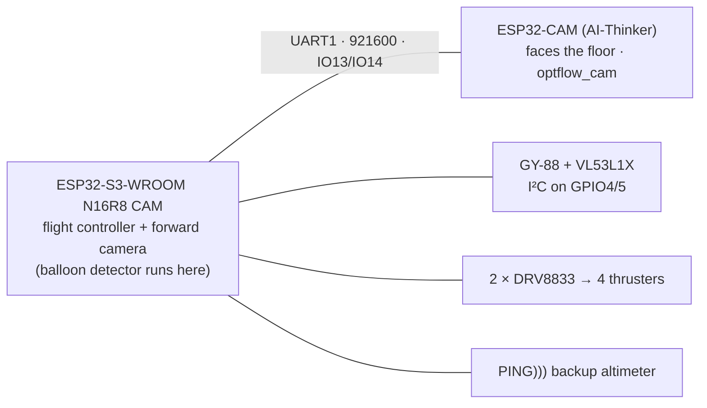

# Wiring revision 3: one ESP32-S3-WROOM N16R8 CAM replaces the S3-Zero and the forward ESP32-CAM

> **Status:** proposal, 2026-10-19. Nothing here has been wired or measured yet.
> **Supersedes** the S3 pin map, the CAM-FWD wiring and the two-UART decision in
> `docs/inter-board-link-plan.md` (rev 2, drawn in the artifact «Cableado del
> blimp, revisión 2»). It **keeps** that plan's CAM-DOWN wiring, protocol,
> phase ordering and side finding, with the changes listed in
> [What carries over](#what-carries-over-from-the-rev-2-link-plan).
>
> **Board assumption.** "ESP32-S3 WROOM N16R8 CAM" is taken to be the Freenove
> ESP32-S3-WROOM CAM board or one of its clones: an ESP32-S3-WROOM-1-N16R8
> module, an OV2640 on a 24-pin FPC, a microSD slot, a WS2812 on IO48, and two
> USB-C ports (native USB and a CH343 USB-UART). Every pin decision below
> depends on that. Item 1 of [Before cutting any wire](#before-cutting-any-wire)
> checks it.

## Context

Rev 2 has three MCUs: the S3-Zero flight controller and two ESP32-CAMs on two
UARTs. The new board puts the forward camera directly on the flight
controller's S3, so the system drops to **two MCUs and one wired link**:

Everything else (the four thrusters, both DRV8833s, the GY-88, the VL53L1X,
the PING))), both 1S cells, F1, F2, S1, S2, D1, the step-up, the motor-battery
divider and the downward ESP32-CAM) stays the same.

The board change creates **three conflicts** with rev 2. They decide the rest
of this plan:

1. **Pins.** The camera is hard-wired to fourteen GPIOs, including GPIO7–13,
   which carry seven of the eight motor lines today.
2. **I²C.** The camera's SCCB bus is hard-wired to GPIO4/5, the pins the GY-88
   and the VL53L1X already use.
3. **LEDC.** `esp32-camera` generates XCLK with an LEDC channel
   (`target/xclk.c`, compiled for the S3), and `cmd_motor.c` uses all eight LEDC
   channels.

---

## The board, and what it leaves free

The camera pin map was confirmed against Freenove's GPIO notes and a working
ESPHome config for this board (sources at the end). It is the same map as
Arduino's `CAMERA_MODEL_ESP32S3_EYE`:

| Signal | GPIO | | Signal | GPIO |
|---|---|---|---|---|
| XCLK | 15 | | Y2…Y5 (D0…D3) | 11, 9, 8, 10 |
| SIOD / SIOC | 4 / 5 | | Y6…Y9 (D4…D7) | 12, 18, 17, 16 |
| VSYNC / HREF / PCLK | 6 / 7 / 13 | | PWDN / RESET | not connected (−1) |

Spoken for by other things on the board:

| GPIO | Taken by | Usable? |
|---|---|---|
| 26–32 | module flash | not broken out |
| 35, 36, 37 | octal PSRAM (the "R8" in N16R8) | **no** |
| 19 / 20 | native USB → the `i2c-tools>` console | no (keep the console) |
| 43 / 44 | UART0 ↔ CH343 USB-UART | no (the CH343 drives 44 whenever it is powered) |
| 48 | on-board WS2812 | the status LED moves here |
| 38, 39, 40 | microSD, 1-bit SDMMC | **yes, if the slot stays empty**, but the lines may have pull-ups |
| 0 | BOOT button (strap, pulled up) | no |
| 3, 45, 46 | straps | yes, with care (see below) |

That leaves **1, 2, 14, 21, 41, 42, 47**, plus 3, 45, 46 (straps) and 38, 39, 40
(SD slot): **13 pins**.

### Pin budget

| Signal | rev 2 pins | Needs |
|---|---|---|
| Motor lines | 8 (GP7–14) | 8, mandatory |
| Motor-battery ADC | 1 (GP1) | 1, mandatory, and it must be ADC1 (GPIO1–10) |
| VL53L1X XSHUT | 1 (GP16) | 1, mandatory |
| CAM-DOWN UART TX/RX | 2 (GP17/18) | 2, mandatory |
| PING))) SIG | 1 (GP38) | 1, mandatory |
| I²C SDA/SCL | 2 (GP4/5) | **0**: shared with the camera's SCCB, see below |
| CAM-FWD UART | 2 (GP2/6) | **0**: the camera is on the board now |
| VL53L1X INT, MPU-6050 INT, logic-battery ADC | 3, all optional | no pins left |

Thirteen mandatory signals, thirteen pins. **It fits exactly, and only if the
I²C bus is shared and the three optional lines are dropped.** Rev 2 already
treats all three as optional: both sensors are polled over I²C today, and the
logic-battery ADC was never wired. If one of them becomes necessary later, the
only remaining pins are 19/20 (losing the native USB console) or 43/44 (losing
the CH343 port). Neither is recommended.

### Why each pin goes where it does

The rule that drives the assignment: **a DRV8833 input that reads high at reset
runs a motor at full VM until `motors_init()` claims the pin.** The DRV8833 has
an internal pull-down (≈ 100 kΩ) on each IN. So motor lines go on pins that
reset low or floating, and pins that might be pulled up get signals that
tolerate it.

- **GPIO45 and GPIO46 → one motor pair (FR).** Both are straps that must read
  low at power-up (45 selects VDD_SPI; low means 3.3 V, which the N16R8's flash
  needs). Both have internal pull-downs at reset, and the DRV8833's own pull-down
  agrees with them. A DRV8833 input is the one load on this airframe that can
  only help these straps. The same pins on a UART would be wrong: CAM-DOWN's
  10 k pull-up on IO13 would pull 45 high through the 470 Ω and the board would
  boot with 1.8 V flash.
- **GPIO38/39/40 → XSHUT and the CAM-DOWN UART.** If the SD lines have pull-ups,
  they are harmless here: a UART RX wants one, TX idles high, and XSHUT is pulled
  up on the ToF400C breakout already. Motors stay off these pins for the reason
  above. The slot must stay empty, the same rule the ESP32-CAM has for IO13/14.
- **GPIO3 → PING))) SIG.** GPIO3's strap (JTAG source) is ignored unless an
  eFuse is burned, as rev 2 already relied on. The divider's 1.8 kΩ to GND holds
  it low at reset.
- **GPIO1 stays the motor-battery ADC.** It is ADC1_CH0 and is free on this
  board, so the divider and its 100 nF don't move.
- **GPIO14 stays RR IN4**, the one motor line that keeps its pin.
- **GPIO47** sits in the VDD_SPI power domain. On the N16R8 that domain is
  3.3 V. If the module turns out to be an "R8V"/1.8 V-flash variant, 47 would
  drive 1.8 V, which is still above the DRV8833's VIH of 1.5 V but with little
  margin. Item 1 below checks the part number.

---

## Pin map, revision 3

| GPIO | Function | vs rev 2 |
|---|---|---|
| 1 | ADC: motor battery, after S1, 100 k + 100 k divider, 100 nF to GND | same |
| 2 | DRV8833 #2 IN3 (RR) | was CAM-FWD UART TX |
| 3 | PING))) 28015 SIG, through the 1.0 k / 1.8 k divider | was free (GP38 in rev 2) |
| 4 / 5 | I²C SDA / SCL: GY-88, VL53L1X **and the camera's SCCB** | same pins, now a shared bus |
| 6–13, 15–18 | camera (on board) | motors, VL53 pins and CAM-DOWN UART moved off |
| 14 | DRV8833 #2 IN4 (RR) | same |
| 21 | DRV8833 #1 IN4 (RL) | was the S3-Zero's LED |
| 38 | VL53L1X XSHUT, open-drain | was GP16 |
| 39 | **UART1 TX → 470 Ω → CAM-DOWN IO13** | was GP17 (UART2) |
| 40 | **UART1 RX ← 470 Ω ← CAM-DOWN IO14**, 10 k pull-up to the S3 board's 3V3 | was GP18 (UART2) |
| 41 / 42 | DRV8833 #1 IN1 / IN2 (FL) | were GP13 / GP12 |
| 47 | DRV8833 #1 IN3 (RL) | was GP11 |
| 45 / 46 | DRV8833 #2 IN1 / IN2 (FR) | were GP9 / GP8 |
| 48 | WS2812 status LED (on board) | was GP21 |
| 19 / 20 | native USB: console and flashing | same role |
| 43 / 44 | UART0 ↔ CH343: bench link for `tcview` | new role |
| 35–37 | octal PSRAM | n/a |
| 0 | BOOT button | same |
| — | VL53L1X INT, MPU-6050 G_INT, HMC5883L DRDY | **unconnected** (polled over I²C) |

The split by side is kept: DRV8833 #1 still carries FL and RL, and #2 carries FR
and RR, so a driver fault still costs one side (the reasoning in
`cmd_motor.c:28-32`). FL/RL/FR/RR and which way each thrusts don't change.

**GPIO2 may have a plain LED on some of these boards.** If yours does, it will
glow with RR's PWM. That's cosmetic, and it costs a few mA.

---

## The shared I²C bus

The camera's SIOD/SIOC are wired to GPIO4/5 on the board, so the GY-88 and the
VL53L1X share the bus with the OV2640. There are no free pins to separate them,
and sharing works cleanly with this firmware:

- **Addresses don't collide:** OV2640 `0x30` (OV3660/OV5640 `0x3C`), MPU-6050
  `0x68`, HMC5883L `0x1E`, BMP180 `0x77`, VL53L1X `0x29`.
- **It's the same driver.** `esp32-camera` 2.1.8 (the version in
  `target_cam/dependencies.lock`) has `sccb-ng.c` on `driver/i2c_master.h`, the
  API `i2c_tools` uses. With `pin_sccb_sda = -1` and `sccb_i2c_port = 0`,
  `esp_camera_init()` attaches to the existing bus (`SCCB_Use_Port`,
  `esp_camera.c:191-196`) and doesn't create its own. Set
  `CONFIG_SCCB_HARDWARE_I2C_DRIVER_NEW=y`. Initialise the camera **after**
  `app_main` creates `tool_bus_handle`.
- **Speed:** every device on the bus already runs at 100 kHz (`IMU_SCL_SPEED_HZ`,
  `BARO_SCL_SPEED_HZ`, `MAG_SCL_SPEED_HZ`), and so does SCCB (`CONFIG_SCCB_CLK_FREQ`).
- **`i2cconfig` must refuse to rebuild the bus while the camera is up.** It
  deletes and recreates `tool_bus_handle`, which would orphan the camera's
  device handle.

The one real cost is the risk rev 2 rejected for "CAMs as I²C slaves": a device
holding SDA low takes out the IMU and the altimeter. It's smaller here because
the OV2640 is a plain register slave that only sees traffic at init and on
settings changes (fixed WB gains, `!flip`), never in the flight loop. If the bus
ever wedges, `i2c_master_bus_reset()` is the recovery. Pull-ups now come from
three boards in parallel (camera board, GY-88, ToF400C), so measure them. At
100 kHz, anything from about 1.5 k to 10 k is fine.

## Motors move from LEDC to MCPWM

`esp32-camera` needs one LEDC timer and one LEDC channel for XCLK. The S3 has
eight channels and `cmd_motor.c` takes all of them. So **the motor back end
moves to MCPWM** and LEDC goes to the camera.

The fit is natural. The S3 has two MCPWM groups, each with three timers and
three operators, and each operator has two generators with their own comparator:

| MCPWM group | Timer | Operator → generators A / B | Motor |
|---|---|---|---|
| 0 | 0 | op 0 → GPIO41 / GPIO42 | FL |
| 0 | 0 | op 1 → GPIO47 / GPIO21 | RL |
| 1 | 0 | op 0 → GPIO45 / GPIO46 | FR |
| 1 | 0 | op 1 → GPIO2 / GPIO14 | RR |

One generator per DRV8833 input, each with its own comparator, keeps the
property that justified eight LEDC channels (`cmd_motor.c:56-63`): reversal
moves comparator values and never reconfigures a pin. Set comparators to update
on timer-empty so a duty change never glitches mid-period. The thrust API, the
decay modes, the deadband and the failsafe (`CONFIG_MOTOR_FAILSAFE_MS`) keep
their behaviour. Only the PWM back end changes. Check the resolution against
`MOTOR_MIN_RES_BITS` (8): at a 10 MHz timer resolution the default 20 kHz
carrier gives 500 steps (≈ 9 bits), and anything above ≈ 39 kHz drops below 256. The IDF
`bdc_motor` component does something similar, but it has its own decay
handling. Keeping the code in `cmd_motor.c` keeps one source of truth.

`motors_init()` still runs first in `app_main`, before the console and now
before the camera too.

---

## Power and mechanics

- **The S3 board's 5V pin is fed from the step-up through D1**, exactly as the
  S3-Zero's was. The same rule applies: don't connect either USB port with S2
  closed.
- **C2 (470 µF ≥ 10 V + 100 nF) moves from the removed CAM-FWD to the S3 board's
  5V pin.** Camera power-up is still the largest current step the forward
  camera takes (`target_main.c:1464`). It now happens on the flight controller,
  so a sag there resets the flight controller, not a peripheral.
- **3V3**: the board's 3V3 pin still feeds the GY-88 and the VL53L1X, as on the
  S3-Zero. The board's LDO now also feeds the S3, the camera's regulators and
  probably the CH343. Read the LDO's part number off the board before trusting
  its headroom.
- **Step-up budget.** Rev 2 worried about 1.0–1.4 A peaks with three MCUs and
  two cameras. Rev 3 has two MCUs and two image sensors, so the peak should drop
  by roughly one ESP32's worth. That's reasoned, not measured. Measure it before
  re-sizing anything.
- **Mass: weigh it, don't assume it.** This is a DevKitC-sized board with two
  USB-C sockets, a CH343, an SD slot and usually soldered headers. The saving
  over S3-Zero + ESP32-CAM + one link harness is real only if the scale says so.
  Desolder the headers and solder wires directly. Rev 2's rate was ≈ 1.3 L of
  helium per gram in Bogotá.
- **Placement.** The flight controller now has to sit where the camera can look
  forward. The stock FPC is short, so its position fixes the board's position.
  Longer OV2640 FPCs exist. Keep the GY-88 away from the board: the Cableado
  already flagged a camera at ≈ 1.3 cm from the compass, and this board brings
  the camera, the S3 and the USB-UART together.

## Removed from rev 2

- The forward ESP32-CAM itself, its C2, its twisted 5 V pair and its dedicated
  ground return.
- S3 UART1 to CAM-FWD (GP2/GP6), both of its 470 Ω resistors and its two 10 k
  pull-ups.
- The IO15-to-GND role wire. The only remaining CAM is the downward one, and
  that is IO15 open, so there is nothing to wire.
- CAM-FWD's flashing procedure. The forward camera now flashes with the flight
  controller over USB, with no BOOT button and no programmer.

## Unchanged from rev 2

- **CAM-DOWN's side of the link, exactly:** it receives on IO13 and transmits on
  IO14, with 470 Ω in series in both lines, a 10 k pull-up on each receiving pin
  to the receiver's own 3V3, C2 470 µF + 100 nF at its 5V pin, its GND taken
  from the pin next to 5V with its own return to the common point, the 5 V pair
  twisted, the microSD slot empty, and IO2/IO12 left free. **The ESP32-CAM
  binary doesn't change for the wiring.** IO15 open already means "downward".
- Motors, DRV8833s, C1, F1/S1, both cells, F2/S2, D1, the step-up, the battery
  divider, the I²C sensors themselves and the PING))) with its divider. Only the
  S3 pins they land on change.
- The rule from rev 2: **don't start the CAM-DOWN UART while that camera is
  unpowered**, because an idle-high TX feeds it through IO13.

---

## Firmware consequences

| Where | Change |
|---|---|
| `i2c_tools/sdkconfig.defaults.esp32s3` | Board comment; `CONFIG_ESPTOOLPY_FLASHSIZE_16MB`; `CONFIG_SPIRAM=y` with `CONFIG_SPIRAM_MODE_OCT=y`; `CONFIG_EXAMPLE_BLINK_GPIO=48`; console stays `USB_SERIAL_JTAG`. SDA/SCL stay 4/5 |
| `i2c_tools/partitions_example.csv` | `factory` is 1 M. `i2c_tools.bin` (377 kB) + `target_cam.bin` (400 kB) already comes to ≈ 0.78 MB before the learned models grow, so make it 3 M (16 MB is available) |
| `main/Kconfig.projbuild` | Motor pin defaults per the map above; help texts that say "correct for the ESP32-S3-Zero" |
| `cmd_motor.c` | LEDC → MCPWM back end (above); header comment rewritten for the new pins |
| `cmd_tof.c` | XSHUT default 16 → 38; INT unconnected |
| `cmd_ping.c` | `PING_GPIO_DEFAULT` 6 → **3**; add back to SRCS (the motors no longer block it) |
| `cmd_i2ctools.c` | `i2cconfig` refuses while the camera owns a device on the bus |
| `target_cam/main/camera_pins.h`, `Kconfig.projbuild` | New board choice, e.g. `TARGETCAM_BOARD_FREENOVE_S3`, with the map above and `CAM_PIN_FLASH_LED -1` |
| `target_cam` camera config | `pin_sccb_sda = -1`, `sccb_i2c_port = 0` in the merged build; LEDC timer/channel stay `TIMER_0`/`CHANNEL_0`, now free |
| `target_cam` output | Today the CSV and the `#!FRAME` link go to stdout on UART0. In the merged build stdout is the USB REPL, so the link must write to **UART0 explicitly** (CH343 port). `DETECTIONS` become an in-process queue to the flight code, not a UART packet |
| `CLAUDE.md`, memory | S3-Zero facts (GPIO21 LED, "port open resets the chip", SDA/SCL) to be revised once the board is on the bench |

**Two USB ports on the bench.** The native port keeps the `i2c-tools>` REPL and
flashing. The CH343 port carries `tcview`'s link on UART0, so `tcview` keeps
working, and the REPL and the viewer never share a port. Both may enumerate as
`/dev/ttyACM*`, so tell them apart with `ls -l /dev/serial/by-id/`. The CH343's
DTR/RTS auto-reset circuit means that **opening the CH343 port can reset the
flight controller.** Check that `tcview` opens the port with DTR/RTS deasserted.
The CH343 should also carry more than 460800 baud, unlike the ESP32-CAM-MB's
CH340, but keep 115200 + `g` as the default until it is measured. `link.c`
already reverts a baud the bridge can't carry.

**The detector's calibration doesn't carry over.** The new camera has a
different module, lens and IR filter. Redo the white-card WB gains, re-check
`TARGETCAM_HFOV_DEG` and re-check the colour LUT (the
`target-cam-fixed-wb-pivot` path: LUT check, maybe retrain). **If the board
ships with an OV3660 or OV5640 instead of an OV2640**, the fixed-WB code writes
OV2640 DSP-bank registers (`target_main.c:85-87, 413-421`) and won't work.
`target_main.c:370` already logs the sensor PID, so read it at first boot.

---

## What carries over from the rev 2 link plan

- **Link decision:** still a point-to-point UART at 921600 by default, for the
  same reasons (only IO13/IO14 are non-strap pins on the CAM). Only one link now,
  so it uses **UART1**; UART2 is not used.
- **Protocol:** `STATE`, `CMD`, `FLOW`, `FRAME_META`/`FRAME_CHUNK`, `LOG`, `BOOT`
  unchanged. `0x82 DETECTIONS` no longer crosses a wire; keep the type number
  reserved. `BOOT.role` still works (IO15 open = downward).
- **Phase 0:** S3 UART1 (GPIO39 TX, GPIO40 RX) to CAM-DOWN's UART0 console.
  Parse the CSV and push `h<mm>`.
- **Phase 1 loopback:** one jumper, **GPIO39 → GPIO40**, with CAM-DOWN
  disconnected.
- **Phases 2–3** for CAM-DOWN are unchanged. **Phase 4** (the balloon detector)
  is now an S3 build, not a CAM reflash. See below.
- **Side finding** (`CONFIG_SPIRAM` on the CAM costing matcher time): unchanged.

## Phases for the board change

Order: prove the board alone, then the motors, then the sensors, then the
camera, then the link. Each step is on a USB-flashable board, so none of them
costs an ESP32-CAM reflash.

**A. Board on the bench, nothing attached.** Identify the module and the camera
(items 1–3 below). Build `target_cam` standalone for `esp32s3` with the new board
choice, console on UART0 as today, and run `tcview` over the CH343 port. This
proves the camera, PSRAM, the pin map and the viewer before any flight code
changes.

**B. Motor back end.** `cmd_motor.c` on MCPWM, still on the S3-Zero if it is
available (the API and pins come from Kconfig, so the old board is a valid test
bench), then on the new board with the new pins. Do the reset-level check (item 4)
**before** connecting VM.

**C. Sensors on the shared bus.** GY-88 and VL53L1X on 4/5 with the camera
**not** initialised: `i2cdetect`, `imu`, `mag`, `baro`, `tof` as today. Then
initialise the camera on the same bus and repeat. PING))) on GPIO3.

**D. Merge.** The detector goes into the flight firmware as a task pinned to one
core, with the flight loop on the other. Its UART0 link stays for `tcview`.
Recalibrate the detector here.

**E. CAM-DOWN link.** The rev 2 phases 0–3 on GPIO39/40.

## Verification

| Stage | Check |
|---|---|
| A | `target_cam` boot log shows PSRAM 8 MB (octal), the sensor PID, and frames in `tcview`; `espefuse.py summary` and `esptool.py flash_id` match an N16R8 |
| B, reset | With RST held, then through a full power-up, every DRV8833 IN line stays < 0.5 V until `motors_init()` runs (meter, then scope on 41, 42, 47, 21, 45, 46, 2, 14) |
| B, straps | With FR braking (45 and 46 both high), force 20 resets (`esp_restart`, the RST button, RTC WDT): the board boots every time. This is the 45/46 strap risk, tested rather than argued |
| B | Every `motor` console test from the motor bring-up passes; reversal under PWM shows no glitch on the scope; the failsafe still coasts all four |
| C | All five devices answer `i2cdetect` with the camera running; 1 h of 50 Hz IMU + ToF reads with the camera streaming shows zero I²C errors; the pull-up value is measured |
| D | 200 Hz estimator loop jitter with and without the detector running; S3 and camera temperatures after 10 min |
| E | The rev 2 link verification table, with GPIO39/40 in place of 17/18 |
| Power | Logic-cell current at the S3 board's 5V during `esp_camera_init()`, and with both cameras streaming; compare with the rev 2 estimate |
| Mass | Weigh the new board (headers removed) against the S3-Zero + ESP32-CAM + harness it replaces |

## Before cutting any wire

1. **Identify the board.** Module marking (`ESP32-S3-WROOM-1-N16R8`, not
   `…R8V`/`R16V`), `esptool.py flash_id`, `espefuse.py summary`. Compare the
   silkscreen with the camera map above. If any camera pin differs, this plan's
   pin map has to be redone, because the budget has no slack.
2. **Identify the camera:** the sensor PID in the boot log (OV2640 = 0x26).
3. **Meter GPIO38/39/40 to 3V3** on the unpowered board to find the SD pull-ups,
   and check whether GPIO2 has an LED.
4. **Reset levels of the eight motor pins**, as in Verification B, before VM is
   connected.
5. **Check GPIO3's strap eFuse** (`STRAP_JTAG_SEL` not burned) before putting the
   PING))) on it.
6. **Count the pins.** This map leaves no spare GPIO. Decide now whether the
   VL53L1X INT or the MPU-6050 INT will ever be needed in flight. If so, the
   design has to change (19/20 or 43/44), and it is cheaper to know before
   soldering.

### Claims I could not verify

- The pin map holds for the board you actually have. It was checked against
  Freenove's GPIO notes and one user's working ESPHome config, not against a
  schematic.
- Whether the SD lines have pull-ups, and whether GPIO2 has an LED.
- The reset-time pull state of GPIO2, 14, 21, 41, 42 and 47 on the S3. The plan
  assumes "not pulled up" and Verification B tests it.
- That a reset taken while 45/46 are driven high always re-straps correctly.
  Reasoned (the pins return to input with pull-downs at chip reset), not
  measured.
- The board's LDO rating, the CH343's power source, and the board's mass.
- The CH343's usable baud rate with this host.

Sources for the camera map, SD pins and PSRAM pins:
[Freenove ESP32-S3-WROOM GPIO notes](https://super-starter-kit-for-esp32-s3-wroom.readthedocs.io/en/latest/_sources/preparation/Notes_For_GPIO.rst.txt),
[ESPHome config for the Freenove ESP32-S3-WROOM CAM (simon42 forum)](https://community.simon42.com/t/esp32-s3-wroom-cam-ueber-esp-home-funktioniert-nicht/53086).
